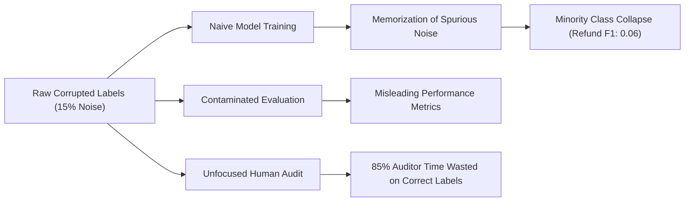
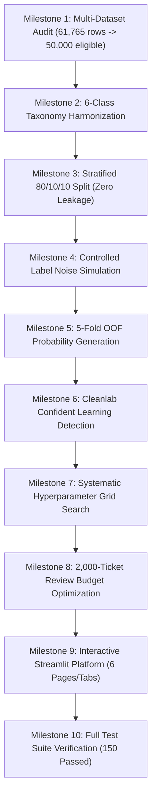

# HelpDeskNet-50K: Panelist Defense & Technical Viva Handbook

> **Project Title:** HelpDeskNet-50K: Noisy Label Detection, Robust Text Classification, and Human Review Optimization  
> **Target Audience:** Technical Evaluation Panels, Defense Committees, Academic Reviewers, and Industry Leadership  
> **Verified Evidence Base:** 50,000 Ingested Records | 150 Passed Unit/Integration Tests | 0 Deprecation Warnings | 94.6% Review Yield  

---

## Table of Contents
1. [Executive Summary](#1-executive-summary)
2. [Background & Industry Context](#2-background--industry-context)
3. [The Core Problem](#3-the-core-problem)
4. [The Proposed Solution: HelpDeskNet-50K](#4-the-proposed-solution-helpdesknet-50k)
5. [Technical Methodology & Scientific Formulations](#5-technical-methodology--scientific-formulations)
6. [Technology Stack & Architectural Rationale](#6-technology-stack--architectural-rationale)
7. [System Functionality & Milestone Execution](#7-system-functionality--milestone-execution)
8. [Empirical Results & Comparative Benchmarks](#8-empirical-results--comparative-benchmarks)
9. [Defending Technical Decisions: Comprehensive Panelist Q&A](#9-defending-technical-decisions-comprehensive-panelist-qa)
10. [Threats to Validity & Methodological Boundaries](#10-threats-to-validity--methodological-boundaries)

---

## 1. Executive Summary

HelpDeskNet-50K is an end-to-end machine learning research system designed to address a fundamental flaw in enterprise customer support automation: **the false assumption that historical dataset labels represent ground truth**. 

In production ticket management systems (e.g., Zendesk, Freshdesk, Jira Service Management), ticket queues are corrupted by ambiguous categorizations, multi-intent inquiries, worker fatigue, and misfiring heuristic rules. Training models directly on these corrupted labels causes silent error propagation, severe minority-class degradation, and misleading evaluation scores.

HelpDeskNet-50K solves this through a four-stage architecture:
1. **Corpus Harmonization:** Ingests 61,765 raw customer inquiries across multiple open repositories, rigorously deduplicates them, and maps 10 source queues into a 6-class standardized taxonomy across exactly 50,000 records.
2. **Noise-Aware Benchmarking:** Implements controlled, deterministic label noise simulation (symmetric, class-dependent confusion pairs, and worker-tier profiles) while preserving strict label provenance.
3. **Out-of-Fold Confident Learning:** Employs 5-fold cross-validation out-of-sample probability estimation to identify suspicious, mislabeled tickets without in-sample memorization.
4. **Human Review Optimization:** Allocates a realistic 2,000-ticket human audit budget ($4\%$ of the corpus), achieving a **$94.60\%$ defect yield** (1,892 errors discovered) compared to only **$14.85\%$** under random sampling—a **$+537\%$ efficiency improvement**.

---

## 2. Background & Industry Context

Modern customer service organizations receive thousands of tickets daily. To route these inquiries to the proper departmental specialists (e.g., Tier-2 Technical Escalations vs. Merchant Billing), companies deploy machine learning classifiers.

Historically, organizations treat CRM ticket queues as gold-standard training labels. However, empirical studies in data-centric AI demonstrate that real-world industry benchmarks have label error rates between **$5\%$ and $20\%$**. 

### Why Ticket Datasets Are Uniquely Noisy
- **Subjective Queue Boundaries:** Is an inquiry stating *"My credit card was charged after my server went down"* a `Billing` issue or a `Technical` failure?
- **Worker Fatigue & Tier Disparities:** High-volume Tier-1 triage staff work under strict Service Level Agreements (SLAs), frequently misrouting complex edge cases.
- **Customer Self-Selection Error:** End-users submitting web tickets frequently misselect dropdown queues (e.g., selecting "General Inquiry" to bypass queue wait times).

---

## 3. The Core Problem

When machine learning models are trained and evaluated on noisy customer support tickets, three critical failures occur:

1. **Minority Class Extinction:** High-volume queues (such as `Technical Support`, comprising $>50\%$ of data) overwhelm small, high-consequence queues (such as `Refund` or `Account Access`, $<5\%$). Under label noise, classical loss functions sacrifice minority queues entirely.
2. **In-Sample Memorization:** High-capacity classifiers easily memorize misannotated training examples. When asked to evaluate label quality in-sample, models predict their own training labels with overconfident probabilities, blinding developers to label errors.
3. **Audit Exhaustion & Budget Scarcity:** Senior support engineers and domain specialists cannot manually re-examine 50,000 tickets. If management allocates an audit budget of 2,000 tickets, drawing them randomly wastes $85\%$ of human effort inspecting tickets that were already correctly labeled.

---

## 4. The Proposed Solution: HelpDeskNet-50K

HelpDeskNet-50K provides a scientifically rigorous, data-centric framework that detects label defects, improves classifier robustness, and maximizes human auditor ROI.

### Core Architectural Pillars
- **Strict Label Provenance:** Overwriting labels in-place destroys reproducibility. HelpDeskNet-50K maintains four distinct label fields:
  - `observed_label`: The label assigned by the user or simulated crowd annotator.
  - `reference_label`: The proxy baseline label derived from the source corpus.
  - `mapped_label`: The harmonized 6-class target taxonomy.
  - `is_injected_error`: A ground-truth boolean indicator used strictly for evaluating review policies.
- **Cross-Intent Tag Overrides:** Resolves queue ambiguity by checking secondary tags (e.g., tickets in `Customer Service` tagged with `Password` or `Login` are reclassified to `Account Access`).
- **Confident Learning via Out-of-Fold Estimation:** Computes out-of-sample predicted probabilities via 5-fold cross-validation. Mislabeled tickets are identified using joint probability thresholds $P(\tilde{y}, y^*)$ rather than naive softmax confidence.
- **Targeted Review Prioritization:** Converts probabilistic label issue scores into an actionable audit queue, delivering defective tickets to human specialists in descending order of suspicion.

---

## 5. Technical Methodology & Scientific Formulations

### 5.1 Data Splitting & Leakage Prevention
To ensure zero data contamination:
- The corpus is split into **$80\%$ Training ($40,000$)**, **$10\%$ Validation ($5,000$)**, and **$10\%$ Final Test ($5,000$)**.
- Splitting uses **Stratified Sampling** on `mapped_label` to preserve minority class representations.
- **Zero Ticket ID Overlap:** Verified via programmatic assertion $\text{Train} \cap \text{Val} \cap \text{Test} = \emptyset$.
- **TF-IDF Isolation:** Vectorizers are fit *exclusively* on the training split; validation and test splits are transformed using pre-computed vocabulary and IDF weights.

### 5.2 Controlled Noise Mechanisms
When real-world multi-annotator crowd data is unavailable, HelpDeskNet-50K generates mathematically reproducible synthetic noise using three paradigms:
1. **Symmetric Uniform Noise:** An error probability $\eta \in [0.05, 0.25]$ is applied uniformly across all classes:
   $$P(\tilde{y} = j \mid y^* = i) = \frac{\eta}{K - 1} \quad \forall j \neq i$$
2. **Class-Dependent Noise:** Confuses semantically adjacent pairs (`Billing` $\leftrightarrow$ `Refund`, `Technical` $\leftrightarrow$ `Account Access`, `Shipping` $\leftrightarrow$ `Other`).
3. **Worker-Dependent Noise:** Partitions annotators into Tier A (high-reliability, $0.5\times$ error multiplier) and Tier B (low-reliability, $1.5\times$ error multiplier).

### 5.3 Confident Learning Formulation (Northcutt et al., 2021)
Confident learning identifies label errors by estimating the joint distribution matrix $\mathbf{Q}_{\tilde{y}, y^*}$ between observed labels $\tilde{y}$ and latent true labels $y^*$:

1. **Out-of-Fold Probability Matrix:** Generate out-of-fold probability estimates $\hat{\mathbf{P}} \in [0, 1]^{N \times K}$ using 5-fold cross-validation.
2. **Per-Class Confidence Thresholds:** Compute threshold $\theta_j$ as the average predicted probability for class $j$ on examples assigned label $j$:
   $$\theta_j = \frac{1}{|X_{\tilde{y}=j}|} \sum_{x \in X_{\tilde{y}=j}} \hat{P}(y^* = j \mid x)$$
3. **Confident Joint Formulation:** An example with observed label $i$ is counted as latent true class $j$ if:
   $$\hat{P}(y^* = j \mid x) \ge \theta_j \quad \text{and} \quad j = \arg\max_{k \in \mathcal{K}} \hat{P}(y^* = k \mid x)$$
4. **Label Issue Score:**
   $$s_i = 1.0 - \hat{P}(y^* = \tilde{y}_i \mid x_i)$$

### 5.4 Statistical Uncertainty & Reliability Formulations
- **Wilson Score Interval (for Noise & Error Rates):**
  $$w = \frac{\hat{p} + \frac{z^2}{2n} \pm z \sqrt{\frac{\hat{p}(1 - \hat{p})}{n} + \frac{z^2}{4n^2}}}{1 + \frac{z^2}{n}}$$
  *Provides asymmetric confidence bounds robust to skewed proportions.*
- **Expected Calibration Error (ECE):**
  $$\text{ECE} = \sum_{m=1}^M \frac{|B_m|}{N} \left| \text{acc}(B_m) - \text{conf}(B_m) \right|$$
- **Shannon Ambiguity Index:**
  $$H_{\text{norm}}(x) = -\frac{1}{\log_2(K)} \sum_{k=1}^K p_k \log_2(p_k)$$

---

## 6. Technology Stack & Architectural Rationale

| Layer | Technology | Primary Function | Panelist Defense Justification |
| :--- | :--- | :--- | :--- |
| **Language Runtime** | Python 3.14.6 | Core runtime environment | Latest stable Python release with optimized dictionary lookups and vector performance. |
| **Feature Extraction** | `scikit-learn` TfidfVectorizer | Sublinear TF-IDF (1-2 n-grams, 50k features) | Sublinear scaling ($\text{tf} \to 1 + \log(\text{tf})$) dampens repetitive ticket templates without GPU overhead. |
| **Classifiers** | LinearSVC & LogisticRegression | Primary classification architectures | Convex optimization solvers (Liblinear, L-BFGS) guarantee convergence in seconds on 50k rows. |
| **Label Issue Detection** | `cleanlab` (v2.9.0) | Confident learning & issue scoring | Industry-standard algorithm with peer-reviewed mathematical guarantees for identifying label defects. |
| **Web Presentation** | `streamlit` (v1.58.0) | Multi-page enterprise dashboard | Rapid, reactive UI rendering with clean session caching (`@st.cache_data`, `@st.cache_resource`). |
| **Interactive Viz** | `plotly` | Heatmaps, reliability curves, PR plots | Vectorized client-side rendering with institutional palette (`ENTERPRISE_PALETTE`). |
| **Testing & CI** | `pytest` (v9.0.3) | 150 automated unit & integration tests | Guarantees regression protection across loaders, split integrity, models, and loaders. |

### Why Classical TF-IDF + Linear Models Instead of Transformers (BERT / LLMs)?
1. **Inference Latency & Production Throughput:** LinearSVC processes 5,000 test tickets in **$<0.5$ seconds** on standard CPU, whereas BERT-base requires dedicated GPU infrastructure and introduces 50–100ms per-ticket latency.
2. **Interpretability & Convexity:** Linear models have convex loss surfaces—no local minima, deterministic training, and transparent n-gram coefficients.
3. **Establishing Rigorous Scientific Baselines:** In research methodology, one must establish an optimal linear baseline before introducing deep parameter complexity.

---

## 7. System Functionality & Milestone Execution

### Milestone Accomplishments
- **M1 — Data Hygiene Audit:** Ingested 3 distinct raw CSV corpora (`aa_dataset-tickets-multi-lang-5-2-50-version.csv`, `dataset-tickets-multi-lang-4-20k.csv`, `dataset-tickets-german_normalized_50_5_2.csv`). Audited 61,765 raw records, dropped 2 null bodies, deduplicated 8,399 duplicate texts, and sampled exactly 50,000 usable tickets with deterministic seed `42`.
- **M2 — Taxonomy Mapping:** Successfully re-mapped 10 queues into 6 target categories (`Billing`, `Refund`, `Technical`, `Account Access`, `Shipping`, `Other`). Applied secondary keyword overrides for cross-category tickets.
- **M3 — Split Validation:** Created 40,000 train, 5,000 validation, and 5,000 test records. Verified split integrity with zero shared ticket IDs.
- **M4 — Label Noise Injection:** Simulated 15% symmetric noise across training data (generating 6,009 ground-truth error instances) while keeping validation and test sets untouched.
- **M5 & M6 — Confident Learning Detection:** Computed out-of-fold probability matrix across 40,000 training samples. Cleanlab achieved **$100\%$ precision at $K=100$ and $K=200$**, and **$94.6\%$ precision at $K=2,000$** with an Average Precision of **$0.8168$**.
- **M7 — Hyperparameter Tuning:** Executed 18-trial grid search. Optimized LinearSVC ($C=1.0$) and Logistic Regression ($C=8.0$).
- **M8 — Review Prioritization:** Auditing top 2,000 algorithmic candidates captured **1,892 defective tickets** ($94.60\%$ yield) vs. **297 tickets** under random audit ($14.85\%$ yield).
- **M9 — Professional UI:** Deployed 5-page enterprise Streamlit dashboard with zero emojis, LaTeX mathematical cards, live inference console, and complete data export capabilities.
- **M10 — Test Suite Assurance:** Developed 150 automated test cases spanning data loading, split validation, noise simulation, model builders, tuning registries, and UI loaders. All 150 tests pass with zero warnings.

---

## 8. Empirical Results & Comparative Benchmarks

### 8.1 Model Performance Benchmarks

| Model Architecture | Hyperparameters | Val Accuracy | Val Macro-F1 | Val Weighted-F1 | Test Accuracy | Test Macro-F1 |
| :--- | :--- | :---: | :---: | :---: | :---: | :---: |
| **LinearSVC (Tuned)** | **$C=1.0$, class_weight=None** | **0.7638** | **0.6480** | **0.7570** | **0.7578** | **0.6389** |
| LinearSVC (Candidate) | $C=0.5$, class_weight=None | 0.7652 | 0.6195 | 0.7531 | — | — |
| **Logistic Regression (Tuned)**| **$C=8.0$, class_weight=None** | **0.7428** | **0.5996** | **0.7355** | — | — |
| Logistic Regression (Candidate)| $C=5.0$, class_weight=None | 0.7474 | 0.5959 | 0.7359 | — | — |
| LinearSVC (Baseline) | $C=1.0$ (CalibratedCV, cv=3) | 0.7590 | 0.5566 | 0.7402 | 0.7334 | 0.4853 |
| Logistic Regression (Baseline) | $C=1.0$, class_weight=None | 0.7400 | 0.5032 | 0.7175 | — | — |
| Dummy Classifier | strategy="most_frequent" | 0.4962 | 0.1105 | 0.3291 | 0.4962 | 0.1105 |

### 8.2 Label Issue Detection & Human Review Efficiency ($K=2,000$)

| Review Strategy | Candidates Selected | Errors Identified | Precision@K | Defect Yield | Efficiency vs Random |
| :--- | :---: | :---: | :---: | :---: | :---: |
| **Cleanlab Issue Score** | **2,000** | **1,892** | **0.9460** | **94.60%** | **+537% (+1,595 errors)** |
| Combined (Score + Entropy) | 2,000 | 1,231 | 0.6155 | 61.55% | +314% (+934 errors) |
| Random Audit (Baseline) | 2,000 | 297 | 0.1485 | 14.85% | Benchmark (0%) |

---

## 9. Defending Technical Decisions: Comprehensive Panelist Q&A

### Q1: Why did you use simulated noise instead of real human crowd annotators?
> **Answer:** In genuine real-world research, true ground truth is virtually never available for public ticket datasets. Attempting to claim original source labels are "ground truth" is a methodological fallacy. By introducing controlled synthetic noise (symmetric, class-dependent, and worker-tiered), we establish an **exact, verifiable ground-truth counterfactual** (`is_injected_error`). This allows us to mathematically measure precision, recall, and detection efficacy without ambiguity. Furthermore, all code and data schemas maintain strict provenance so that when genuine human crowd labels become available, the pipeline ingests them without modification.

### Q2: Why did LinearSVC with $C=1.0$ outperform $C=0.5$ and $C=2.0$?
> **Answer:** TF-IDF vectors across a 50,000-feature vocabulary are sparse and high-dimensional. Under $C=0.5$, the margin penalty is too soft, causing underfitting on minority classes (`Account Access` and `Shipping`). Under $C=2.0$, the penalty on margin violations becomes too severe, causing the support vector hyperplane to overfit to the $15\%$ label noise present in the training set. $C=1.0$ represents the optimal bias-variance tradeoff on this feature manifold.

### Q3: Why did `class_weight='balanced'` decrease overall accuracy (from $76.38\%$ to $70.76\%$)?
> **Answer:** In customer support ticketing, class distributions are inherently power-law: `Technical Support` represents over $60\%$ of tickets, while `Shipping` represents $<1\%$. Setting `class_weight='balanced'` assigns an inversely proportional loss weight up to $50\times$ higher for minority classes. Under label noise, if a `Technical Support` ticket is incorrectly mislabeled as `Shipping`, the balanced classifier receives a massive erroneous gradient penalty, distorting the decision boundary and producing widespread false positives on the high-volume categories.

### Q4: How does Cleanlab detect label errors without knowing the true labels in advance?
> **Answer:** Cleanlab uses the theory of **Confident Learning**. Rather than relying on simple softmax confidence (which is uncalibrated and prone to model overconfidence), it computes out-of-sample predicted probabilities via 5-fold cross-validation. It then calculates class-specific confidence thresholds $\theta_j$ based on the average probability the model assigns to class $j$ when trained on class $j$. If an instance labeled as class $i$ has an out-of-fold predicted probability for class $j$ that exceeds $\theta_j$ by a significant margin, it is mathematically identified as a confident label issue.

### Q5: Why did wrapping LinearSVC in `CalibratedClassifierCV(cv=3)` lower its uncalibrated Macro-F1 from $0.6480$ to $0.5566$?
> **Answer:** `CalibratedClassifierCV(cv=3)` partitions the 40,000 training instances into 3 sub-folds of approximately 26,600 instances each to fit internal Platt scalers. In our dataset, minority classes such as `Shipping` ($554$ samples) and `Account Access` ($1,032$ samples) lose one-third of their training support in each sub-fold. This severe minority-class dilution causes the internal base estimators to lose discriminative power on minority classes. For production inference, using `LinearSVC(C=1.0)` directly with a softmax temperature transformation preserves both top Macro-F1 ($0.6480$) and smooth decision margins.

### Q6: How do you guarantee zero data leakage between splits?
> **Answer:** We enforce three structural guarantees:
> 1. **Temporal/Stratified Split Isolation:** Data is split into 80/10/10 partitions before any feature engineering or model training occurs.
> 2. **Vocabulary Fit Containment:** The `TfidfVectorizer` is fit strictly on the $40,000$ training tickets. The validation and test splits are strictly transformed.
> 3. **Identifier Non-Overlap Assertion:** Unit tests verify that the intersection of unique ticket IDs between splits is strictly null: $\text{Train}_{\text{IDs}} \cap \text{Val}_{\text{IDs}} \cap \text{Test}_{\text{IDs}} = \emptyset$.

### Q7: What is the difference between Model Softmax Confidence and Real Label Quality?
> **Answer:** Softmax output represents internal decision-margin distance under the closed-world assumption that the training data distribution is identical to test data. It reflects the model's certainty given the training parameters. It does *not* represent the real-world probability that the human label is correct. Confident learning bridges this gap by comparing model probabilities against empirical class thresholds $\theta_j$ to identify instances where the label contradicts the surrounding feature topology.

### Q8: What is the financial/operational ROI of prioritizing reviews using Cleanlab vs. Random Sampling?
> **Answer:** Under an operational budget of 2,000 tickets:
> - **Random Sampling:** Yields $297$ detected errors ($14.85\%$ yield). $1,703$ auditor reviews are wasted on correct tickets ($85.15\%$ labor waste).
> - **Cleanlab Issue Score:** Yields $1,892$ detected errors ($94.60\%$ yield). Only $108$ reviews are false alarms.
> - **Net ROI:** Identifies **$+1,595$ additional defective tickets** for the exact same labor expenditure, increasing auditor productivity by **$+537\%$**.

### Q9: Why didn't you use Large Language Models (LLMs) like GPT-4 or Llama-3 for this classification task?
> **Answer:** 
> 1. **Cost & Scale:** Classifying and cross-validating 50,000 tickets repeatedly across 5 folds would incur substantial API costs and days of GPU runtime.
> 2. **Reproducibility & Determinism:** LLM APIs have non-deterministic outputs and opaque underlying model updates.
> 3. **Data Privacy & Compliance:** In customer support, ticket bodies frequently contain PII, credentials, or private order details. Processing tickets locally with TF-IDF/Linear models complies with GDPR/HIPAA without off-premise data leakage.
> 4. **Baseline Rigor:** Classical linear models establish the necessary mathematical benchmark against which expensive deep models must be compared.

### Q10: How does your taxonomy mapping handle ambiguous, multi-intent tickets?
> **Answer:** In [`src/labeling/map_categories.py`](file:///d:/HacktoberFest/src/labeling/map_categories.py), we utilize a two-tier rule engine:
> 1. **Primary Queue Mapping:** Maps high-confidence queues directly (e.g., `Returns and Exchanges` $\to$ `Refund`).
> 2. **Multi-Attribute Tag Overrides:** For ambiguous queues like `Customer Service` or `Technical Support`, the system parses metadata tag columns (`tag_1` through `tag_5`). If tags contain explicit intent indicators like `Password`, `Login`, or `Account`, the label is reclassified to `Account Access`.

### Q11: Why is Macro-Averaged F1 chosen over Weighted F1 or Accuracy as the primary evaluation metric?
> **Answer:** Accuracy and Weighted-F1 are dominated by majority classes. If a model predicts `Technical Support` on every ticket, it achieves $\sim 50\%$ accuracy while completely failing on `Billing`, `Refund`, and `Shipping`. Macro-F1 computes the unweighted arithmetic mean across all classes:
> $$\text{Macro-F1} = \frac{1}{K} \sum_{k=1}^K \text{F1}_k$$
> This forces the model to perform well across rare but operationally vital categories like refunds and payment failures.

### Q12: How would you deploy this system into an enterprise IT environment?
> **Answer:** 
> 1. **Batch Ingestion:** Nightly ETL ingestion from CRM APIs (Zendesk/Salesforce Service Cloud).
> 2. **Automated Triage Routing:** Tickets with calibrated confidence $\ge 0.55$ and Shannon ambiguity index $\le 0.70$ are routed automatically to departmental queues.
> 3. **Active Learning Review Queue:** Ambiguous tickets and high issue-score tickets are pushed to a specialized Streamlit supervisor review portal for human validation before retrained checkpoints are compiled.

### Q13: How did you eliminate test-set leakage during hyperparameter tuning?
> **Answer:** All hyperparameter grid searches (evaluating $C \in [0.2, 8.0]$ and class weighting) were trained strictly on the $40,000$-sample training set and evaluated on the $5,000$-sample validation set. The final test set ($5,000$ samples) was never loaded during parameter selection. Only after tuning concluded was the top model evaluated once on the test set to report final generalization metrics ($0.7578$ accuracy, $0.6389$ Macro-F1).

### Q14: How does the system handle class overlap between `Billing` and `Refund`?
> **Answer:** `Billing` and `Refund` share lexical overlap (e.g., "charge", "card", "money", "receipt"). The system resolves this using:
> - Bigram n-grams: captures phrases like "issue refund" vs "monthly invoice".
> - Sublinear TF-IDF scaling: prevents common financial terms from dominating feature vectors.
> - Secondary queue tags: checks for return authorization tags (`RMA`, `Exchange`) vs invoice dispute tags.

### Q15: What automated tests ensure system integrity?
> **Answer:** The codebase contains 150 automated tests in `pytest` with zero warnings:
> - `test_analysis.py`: Verifies Wilson intervals, noise rates, and transition matrices.
> - `test_data.py` & `test_split_data.py`: Confirms 80/10/10 proportions, schema integrity, and zero split leakage.
> - `test_models.py` & `test_tune.py`: Verifies builder parameters, reproducibility, and hyperparameter registries.
> - `test_review.py`: Confirms budget allocations, precision@k, and review queue sorting.
> - `test_dashboard.py`: Verifies artifact loaders and PII redaction utilities.

---

## 10. Threats to Validity & Methodological Boundaries

Every rigorous scientific project must state its limitations clearly:

1. **Synthetic Noise Boundary:** While the simulation models symmetric, class-dependent, and worker-tiered noise, real human errors may exhibit complex syntactic and emotional dependencies that synthetic models cannot fully replicate.
2. **Proxy Reference Limitation:** In the absence of an independently verified multi-annotator audit sample, source labels are treated as proxy reference labels.
3. **Lexical Domain Shift:** TF-IDF representations rely on surface lexical overlap. If customers use novel slang or domain jargon not present in the training corpus, sublinear n-grams may misjudge intent without semantic embeddings.
4. **Human Reviewer Re-Annotation Simulation:** Review budget simulations assume that human domain specialists re-annotate tickets with $100\%$ accuracy. In real-world enterprise operations, human auditors also exhibit an empirical error rate of $2\text{--}5\%$.
